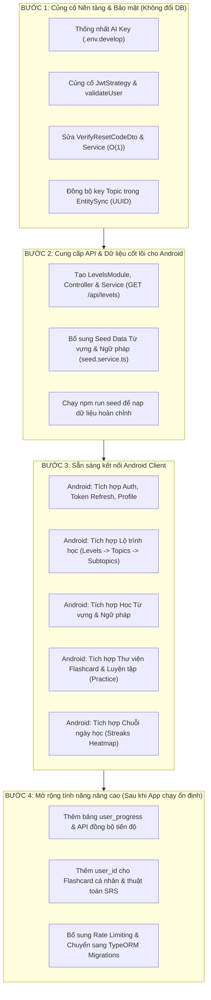

# KẾ HOẠCH XỬ LÝ KHOẢNG TRỐNG VÀ HOÀN THIỆN BACKEND NIHONIX (BACKEND GAP RESOLUTION PLAN)

> **Mục tiêu**: Xác minh độc lập toàn bộ các phát hiện kỹ thuật trên mã nguồn thực tế, phân loại mức độ ưu tiên, đánh giá ảnh hưởng đến ứng dụng Android và thiết lập lộ trình xử lý tối ưu, không làm gián đoạn các phần đang hoạt động tốt.  
> **Thời điểm lập kế hoạch**: Tháng 11/2026  
> **Nguyên tắc**: Giữ nguyên mã nguồn ở bước này, ưu tiên giải pháp ít xâm lấn (least-invasive), phân định rõ việc bắt buộc trước khi làm Android vs việc có thể làm sau.

---

## PHẦN 1: BÁO CÁO XÁC MINH CÁC VẤN ĐỀ TRÊN SOURCE CODE THỰC TẾ

Dưới đây là kết quả kiểm tra trực tiếp từng dòng code (code-level verification) của 9 vấn đề trọng tâm:

### 1. Lỗ hổng JWT Security & User Status Validation
- **Vị trí mã nguồn**: 
  - [jwt.strategy.ts:24, 28-36](file:///c:/Users/Ngoc%20Anh/Desktop/CETA/nihonix-server-dev/src/modules/auth/strategies/jwt.strategy.ts#L24)
  - [auth.service.ts:311-326](file:///c:/Users/Ngoc%20Anh/Desktop/CETA/nihonix-server-dev/src/modules/auth/auth.service.ts#L311) (`validateUser`)
- **Xác minh thực tế**:
  1. `JwtStrategy` có fallback nguy hiểm: `secretOrKey: configService.get<string>('jwt.secret') || 'default-secret'`. Nếu biến môi trường bị thiếu, toàn bộ token được ký/giải mã bằng secret cố định.
  2. `validate(payload: JwtPayload)` nhận `tokenVersion` từ payload nhưng chỉ chuyển `payload.sub` sang `authService.validateUser(payload.sub)`.
  3. Hàm `validateUser(userId)` chỉ tìm user trong bảng `users` mà **hoàn toàn không kiểm tra**:
     - `user.status === 'active'` (user bị khóa vẫn gửi token gọi API bình thường).
     - `user_auth.token_version === payload.tokenVersion` (user đổi mật khẩu hoặc đăng xuất, access token cũ vẫn tiếp tục gọi API thành công cho đến khi hết hạn 15 phút).
- **Kết luận**: **ĐÚNG THỰC TẾ**. Lỗ hổng bảo mật mức độ Cao (High).

---

### 2. Thuật toán quét tuyến tính OTP Reset Password (Linear Bcrypt Scan)
- **Vị trí mã nguồn**:
  - [forgot-password.dto.ts:9-12](file:///c:/Users/Ngoc%20Anh/Desktop/CETA/nihonix-server-dev/src/modules/auth/dto/forgot-password.dto.ts#L9) (`VerifyResetCodeDto`)
  - [auth.service.ts:395-415](file:///c:/Users/Ngoc%20Anh/Desktop/CETA/nihonix-server-dev/src/modules/auth/auth.service.ts#L395) (`verifyResetCode`)
- **Xác minh thực tế**:
  1. `VerifyResetCodeDto` chỉ khai báo 1 trường duy nhất: `@IsString() code: string;`, không có `email`.
  2. `verifyResetCode` truy vấn: `this.verificationTokenRepository.find({ where: { type: 'password_reset', used_at: IsNull() } })`.
  3. Server duyệt mảng bằng vòng lặp `for...of` và chạy hàm `bcrypt.compare(code, token.token_hash)` trên từng token của **mọi user đang có mã chờ** trong DB.
  4. Nếu có 20 yêu cầu reset cùng lúc, việc băm 20 lần tuần tự có thể làm nghẽn CPU Node.js (event loop lag 1-2 giây) và tiềm ẩn nguy cơ xung đột nếu trùng mã 6 số ngẫu nhiên giữa 2 user.
- **Kết luận**: **ĐÚNG THỰC TẾ**. Lỗi kiến trúc mức độ Cao (High).

---

### 3. Thiếu API Cấp độ độc lập (`Levels API`)
- **Vị trí mã nguồn**:
  - [src/modules/levels/](file:///c:/Users/Ngoc%20Anh/Desktop/CETA/nihonix-server-dev/src/modules/levels/) chỉ có thư mục `entity/` chứa `level.entity.ts`.
  - [app.module.ts:16-47](file:///c:/Users/Ngoc%20Anh/Desktop/CETA/nihonix-server-dev/src/app.module.ts#L16): Không import bất kỳ `LevelsModule` nào.
- **Xác minh thực tế**:
  - Không có `levels.controller.ts`, `levels.service.ts`.
  - Endpoint `GET /api/levels` trả về HTTP 404 Not Found.
  - Client Android không có cách trực tiếp lấy danh sách các Level hỗ trợ trừ khi bóc tách từ quan hệ `topic.level` hoặc gọi qua `POST /api/entity-sync/check`.
- **Kết luận**: **ĐÚNG THỰC TẾ**. Mức độ: Blocker đối với Android.

---

### 4. Dữ liệu Từ vựng và Ngữ pháp trong DB đang trống (0 bản ghi)
- **Vị trí mã nguồn**:
  - [scripts/seed-all.ts:1-77](file:///c:/Users/Ngoc%20Anh/Desktop/CETA/nihonix-server-dev/scripts/seed-all.ts#L1)
  - [src/services/seed/seed.service.ts:1-250](file:///c:/Users/Ngoc%20Anh/Desktop/CETA/nihonix-server-dev/src/services/seed/seed.service.ts#L1)
- **Xác minh thực tế**:
  - Hàm `seedAll()` chỉ gọi: `seedLevels()`, `seedTopics()`, `seedGrammarSubTopics()`, `seedDetailedGrammarSubTopics()`.
  - Hoàn toàn **không có** `seedVocabularyItems()` hay `seedGrammarPatterns()`.
  - Thư mục `docs/feat/` có sẵn file mẫu `04-vocabulary-items-examples.json` và `05-grammar-patterns-examples.json` nhưng chưa được nạp vào seed script.
  - Bảng `vocabulary_items` và `grammar_patterns` trong DB hiện có **0 bản ghi**.
  - Hệ thống đang thiết kế để sinh dữ liệu này qua AI endpoint (`/generate`), nhưng nếu chưa gọi AI thì app Android vào màn hình học từ vựng/ngữ pháp sẽ không có gì hiển thị, đồng thời API luyện tập (`/practice/...`) sẽ báo lỗi do thiếu dữ liệu gốc.
- **Kết luận**: **ĐÚNG THỰC TẾ**. Mức độ: Blocker về mặt nội dung cho Android.

---

### 5. Chưa có cơ chế theo dõi tiến độ học tập (`User Learning Progress`)
- **Vị trí mã nguồn**:
  - Toàn bộ 18 entities trong [data-source.ts:60-78](file:///c:/Users/Ngoc%20Anh/Desktop/CETA/nihonix-server-dev/data-source.ts#L60) và `src/modules/`.
- **Xác minh thực tế**:
  - Module `learning-streaks` chỉ theo dõi chuỗi ngày liên tiếp (`current_streak`, `activity_count`), không lưu vết nội dung đã học.
  - Module `practice` chỉ lưu phiên làm bài test trắc nghiệm/điền từ (`practice_sessions`).
  - **Không có bảng hay API nào** lưu trạng thái: Topic này user đã hoàn thành chưa? Từ vựng này user đã thuộc chưa? Mẫu ngữ pháp này đã nắm vững chưa?
- **Kết luận**: **ĐÚNG THỰC TẾ**. Mức độ: Cốt lõi nghiệp vụ (Business Blocker).

---

### 6. Quyền sở hữu Flashcard (Global vs Personal Decks)
- **Vị trí mã nguồn**:
  - [flashcard-folder.entity.ts:10-33](file:///c:/Users/Ngoc%20Anh/Desktop/CETA/nihonix-server-dev/src/modules/flashcard-folders/entity/flashcard-folder.entity.ts#L10)
  - [flashcard-set.entity.ts:17-48](file:///c:/Users/Ngoc%20Anh/Desktop/CETA/nihonix-server-dev/src/modules/flashcards/entity/flashcard-set.entity.ts#L17)
  - [flashcard.entity.ts:15-56](file:///c:/Users/Ngoc%20Anh/Desktop/CETA/nihonix-server-dev/src/modules/flashcards/entity/flashcard.entity.ts#L15)
- **Xác minh thực tế**:
  - Cả 3 bảng `flashcard_folders`, `flashcard_sets`, `flashcards` **không có cột `user_id`**.
  - Dù Controller có `@UseGuards(JwtAuthGuard)`, Service không gắn bất kỳ ID người dùng nào vào bản ghi.
  - Bất kỳ user nào cũng có thể đọc, sửa, xóa toàn bộ thư mục và thẻ flashcard của hệ thống.
  - Chưa có bảng và thuật toán lưu lịch ôn tập lặp lại ngắt quãng (Spaced Repetition / Leitner).
- **Kết luận**: **ĐÚNG THỰC TẾ**. Cần xác nhận quyết định nghiệp vụ (Business Decision).

---

### 7. Lệch cấu hình nhà cung cấp AI (Gemini vs OpenRouter)
- **Vị trí mã nguồn**:
  - [configuration.ts:43-44](file:///c:/Users/Ngoc%20Anh/Desktop/CETA/nihonix-server-dev/src/config/configuration.ts#L43) (`provider: 'gemini'`, `model: 'gemini-2.0-flash'`)
  - [ai.module.ts:17-23](file:///c:/Users/Ngoc%20Anh/Desktop/CETA/nihonix-server-dev/src/modules/ai/ai.module.ts#L17) (Inject cố định `GeminiProvider` cho `AiGenerationService`)
  - [env.md:5](file:///c:/Users/Ngoc%20Anh/Desktop/CETA/nihonix-server-dev/env.md#L5) (Lưu key `OPENROUTER_API_KEY`)
- **Xác minh thực tế**:
  - `AiGenerationService` luôn dùng `GeminiProvider`.
  - `GeminiProvider` gọi endpoint `generativelanguage.googleapis.com` với header `X-goog-api-key: apiKey`.
  - Nếu đưa key OpenRouter vào cấu hình mà không đổi code, lệnh gọi sinh dữ liệu bằng AI sẽ trả về HTTP 400 Bad Request từ Google.
- **Kết luận**: **ĐÚNG THỰC TẾ**. Mức độ: Trung bình (chỉ cần thống nhất biến môi trường hoặc cấu hình Provider).

---

### 8. Lệch khóa đồng bộ EntitySync của Topic (`topic.id` vs `topic.slug`)
- **Vị trí mã nguồn**:
  - [topic-sync.strategy.ts:49-51](file:///c:/Users/Ngoc%20Anh/Desktop/CETA/nihonix-server-dev/src/modules/entity-sync/strategies/topic-sync.strategy.ts#L49): `getEntityKey(entity: Topic): string { return entity.slug; }`
  - [topics.service.ts:31-36, 115-121](file:///c:/Users/Ngoc%20Anh/Desktop/CETA/nihonix-server-dev/src/modules/topics/services/topics.service.ts#L31):
    ```ts
    const ids = topics.map(t => t.id);
    const syncRecords = await this.entitySyncRepository.find({
      where: { entity_kind: EntityKind.TOPIC, entity_key: In(ids) },
    });
    ```
- **Xác minh thực tế**:
  - `TopicsService` lưu và đọc ETag trong bảng `entity_sync` với `entity_key = topic.id` (UUID).
  - Nhưng `TopicSyncStrategy` (dùng cho API `/api/entity-sync/check`) lại định nghĩa `entity_key = topic.slug`!
  - Khi client gọi `/api/entity-sync/check` với `entityKind: 'topic'`, server so sánh bằng `slug` và sẽ không tìm thấy ETag đã lưu bằng `id`, dẫn đến việc client luôn bị báo `changed` dù dữ liệu không đổi.
- **Kết luận**: **ĐÚNG THỰC TẾ**. Mức độ: Lỗi logic đồng bộ Offline.

---

### 9. Thiếu Rate Limiting toàn hệ thống
- **Vị trí mã nguồn**: `package.json`, `app.module.ts`, `main.ts`.
- **Xác minh thực tế**: Hoàn toàn không có `@nestjs/throttler` hoặc middleware rate limit.
- **Kết luận**: **ĐÚNG THỰC TẾ**. Mức độ: Trung bình (Cần thiết trước khi ra môi trường Production).

---

## PHẦN 2: PHÂN LOẠI MỨC ĐỘ ƯU TIÊN VÀ PHẠM VI ẢNH HƯỞNG

Dựa trên mục tiêu chuẩn bị cho **Giai đoạn Tích hợp Android**, các vấn đề được phân tách rõ ràng thành 2 nhóm:

```
┌────────────────────────────────────────────────────────────────────────┐
│                   NHÓM A: BẮT BUỘC XỬ LÝ TRƯỚC                          │
│         (Must-Fix Before/During Early Android Integration)             │
├────────────────────────────────────────────────────────────────────────┤
│ 1. Bổ sung Levels API (GET /api/levels)                                │
│ 2. Khởi tạo dữ liệu mẫu Từ vựng & Ngữ pháp vào Database                │
│ 3. Sửa lỗi lệch khóa ETag Topic (id vs slug) trong EntitySync          │
│ 4. Sửa luồng Reset Password OTP (thêm email vào DTO & truy vấn O(1))   │
│ 5. Sửa bảo mật JwtStrategy (kiểm tra user.status & token_version)      │
│ 6. Thống nhất AI API Key trong môi trường (.env.develop)                │
└──────────────────────────────────┬─────────────────────────────────────┘
                                   │
                                   ▼
┌────────────────────────────────────────────────────────────────────────┐
│                   NHÓM B: CÓ THỂ TRIỂN KHAI SAU                         │
│            (Post-Integration / Advanced Features / Non-Blocking)       │
├────────────────────────────────────────────────────────────────────────┤
│ 1. Triển khai Module Theo dõi Tiến độ học tập (User Progress Tracking)  │
│    -> Android tạm thời lưu tiến độ vào Room DB local.                  │
│ 2. Tách Flashcard thành Bộ thẻ Cá nhân (Personal Decks + user_id)      │
│    -> Giai đoạn 1 coi Flashcard là Thư viện bài học chung của hệ thống. │
│ 3. Triển khai Thuật toán Lặp lại ngắt quãng (Spaced Repetition System)  │
│ 4. Tích hợp Rate Limiting (@nestjs/throttler)                          │
│ 5. Chuyển đổi từ synchronize: true sang Migration SQL chính thức        │
│ 6. Tính năng Bookmark, Search tập trung, Push Notifications            │
└────────────────────────────────────────────────────────────────────────┘
```

---

## PHẦN 3: CHI TIẾT GIẢI PHÁP ĐỀ XUẤT CHO TỪNG VẤN ĐỀ

### 1. Bổ sung Levels API (`GET /api/levels`)
- **Mức độ**: 🔴 **CRITICAL BLOCKER**
- **Ảnh hưởng Android**: Android cần danh sách Level (N5 -> N1) để hiển thị màn hình chọn lộ trình, bộ lọc bài học.
- **Giải pháp ít xâm lấn nhất**:
  - Tạo `src/modules/levels/levels.service.ts` và `src/modules/levels/levels.controller.ts`.
  - Tạo `src/modules/levels/levels.module.ts` import `TypeOrmModule.forFeature([Level])` và export Service.
  - Đăng ký `LevelsModule` vào `app.module.ts`.
  - Cung cấp 2 API công khai:
    - `GET /api/levels`: Lấy danh sách Level sắp xếp theo `order ASC`.
    - `GET /api/levels/:code`: Lấy chi tiết level theo code (N5..N1).
- **Thay đổi Database**: Không thay đổi (Bảng `levels` đã có sẵn dữ liệu N5, N4, N3).

---

### 2. Nạp dữ liệu mẫu Từ vựng & Ngữ pháp vào Database
- **Mức độ**: 🔴 **CONTENT BLOCKER**
- **Ảnh hưởng Android**: Nếu không có dữ liệu này, toàn bộ màn hình danh sách từ vựng, chi tiết từ vựng, ngữ pháp và màn hình luyện tập của Android sẽ không có dữ liệu để hiển thị hoặc phát sinh lỗi 400.
- **Giải pháp**:
  - Bổ sung 2 hàm seed vào `src/services/seed/seed.service.ts`:
    - `seedVocabularyItems()`: Đọc từ `docs/feat/04-vocabulary-items-examples.json` (hoặc dữ liệu mẫu chuẩn N5) và lưu vào `vocabulary_sets` + `vocabulary_items`.
    - `seedGrammarPatterns()`: Đọc từ `docs/feat/05-grammar-patterns-examples.json` và lưu vào `grammar_patterns`.
  - Gọi 2 hàm này trong `seedAll()`.
- **Thay đổi Database**: Chỉ thêm dữ liệu vào bảng hiện có, không đổi cấu trúc cột.

---

### 3. Sửa lỗi lệch khóa ETag Topic trong EntitySync
- **Mức độ**: 🟡 **HIGH (Data Consistency)**
- **Ảnh hưởng Android**: Khi Android triển khai tính năng Offline Sync kiểm tra thay đổi dữ liệu bằng ETag, hàm `checkSync` sẽ luôn báo Topic bị thay đổi (tải lại liên tục) vì lệch key giữa UUID và Slug.
- **Giải pháp**:
  - Thống nhất dùng `topic.id` (UUID) làm `entity_key` trong `TopicSyncStrategy`:
    - Sửa `getEntityKey(entity: Topic): string { return entity.id; }`
    - Sửa `findOne(entityKey: string)` tìm theo `where: { id: entityKey }`.
- **Thay đổi Database**: Không thay đổi schema.

---

### 4. Tối ưu luồng xác minh mã OTP Quên mật khẩu
- **Mức độ**: 🟡 **HIGH (Security & Performance)**
- **Ảnh hưởng Android**: Màn hình "Nhập mã xác thực" trên Android chỉ cần gửi thêm trường `email` lên server cùng với `code`.
- **Giải pháp**:
  - Cập nhật `VerifyResetCodeDto`: Thêm `@IsEmail() email: string;`.
  - Trong `AuthService.verifyResetCode`:
    - Tìm user theo `email`.
    - Tìm token của user: `where: { user_id: user.id, type: 'password_reset', used_at: IsNull() }`.
    - So sánh bcrypt duy nhất với token này (độ phức tạp O(1) thay vì O(N)).
- **Thay đổi Database**: Không thay đổi.

---

### 5. Củng cố bảo mật JWT và Kiểm tra trạng thái tài khoản
- **Mức độ**: 🟡 **HIGH (Security)**
- **Ảnh hưởng Android**: Đảm bảo khi user bị vô hiệu hóa hoặc đăng xuất từ xa, token cũ sẽ bị từ chối ngay lập tức, kích hoạt luồng đăng nhập lại trên Android.
- **Giải pháp**:
  - Trong `jwt.strategy.ts`: Bỏ fallback `'default-secret'`, ném lỗi nếu thiếu biến môi trường.
  - Cập nhật `AuthService.validateUser(userId: string, tokenVersion?: number)`:
    - Kiểm tra `user.status === 'active'`. Nếu không phải active -> Ném lỗi `UnauthorizedException('User account is inactive or suspended')`.
    - Lấy `user_auth.token_version`. Nếu `tokenVersion !== undefined && userAuth.token_version !== tokenVersion` -> Ném lỗi `UnauthorizedException('Token has been revoked')`.
- **Thay đổi Database**: Không thay đổi.

---

### 6. Thống nhất cấu hình AI Key trong môi trường
- **Mức độ**: 🟢 **MEDIUM**
- **Ảnh hưởng Android**: Các tính năng gọi sinh bài tập AI (`/practice/fill-blank`, `/practice/multiple-choice`) hoạt động ổn định.
- **Giải pháp**:
  - Trong `.env.develop`: Sử dụng biến `GOOGLE_API_KEY=<Key_Google_Gemini>` thay vì OpenRouter key.

---

### 7. Lộ trình tính năng Tiến độ học tập (User Progress)
- **Mức độ**: 🔵 **FUTURE ENHANCEMENT (Giai đoạn sau)**
- **Đánh giá**:
  - Đây là chức năng lớn cần bảng mới `user_progress` (`id`, `user_id`, `item_type: 'topic'|'vocab'|'grammar'`, `item_id`, `status: 'in_progress'|'completed'`, `last_reviewed_at`).
  - **Khuyến nghị cho Android**: Ở giai đoạn tích hợp đầu tiên (Sprint 1-2), Android Client lưu tiến độ người dùng vào **Room Database / DataStore** nội bộ trên máy. Khi Backend hoàn thiện module `UserProgressModule` ở Sprint sau, Android chỉ cần đẩy dữ liệu đồng bộ lên máy chủ.

---

### 8. Lộ trình tính năng Flashcard cá nhân & Spaced Repetition (SRS)
- **Mức độ**: 🔵 **FUTURE ENHANCEMENT (Giai đoạn sau)**
- **Đánh giá**:
  - Giai đoạn đầu: Ứng dụng Android coi toàn bộ Flashcard hiện có là **"Thư viện Flashcard bài học chung"** (do hệ thống cung cấp) để người dùng lật thẻ ôn tập từ vựng theo chủ đề.
  - Giai đoạn nâng cao: Bổ sung cột `user_id` (nullable - null là bài học chung, có giá trị là bài cá nhân của user) và bảng `user_flashcard_progress` để lưu khoảng cách lặp lại ôn tập SM-2.

---

## PHẦN 4: THỨ TỰ TRIỂN KHAI VÀ QUAN HỆ PHỤ THUỘC (DEPENDENCY ROADMAP)



---

## PHẦN 5: CÁC API VÀ CHỨC NĂNG HOẠT ĐỘNG TỐT - GIỮ NGUYÊN CHO ANDROID

Các nhóm API sau đây đã được kiểm tra, hoạt động chuẩn xác và **hoàn toàn giữ nguyên** để Android kết nối:

1. **Authentication API**:
   - `POST /api/auth/register`
   - `POST /api/auth/login`
   - `POST /api/auth/refresh`
   - `POST /api/auth/logout`
   - `POST /api/auth/me`
   - `POST /api/auth/forgot-password`
   - `POST /api/auth/reset-password`
   - `POST /api/auth/resend-code`
2. **User Profile API**:
   - `GET /api/users/me/level`
   - `PATCH /api/users/me/level`
   - `PUT /api/users/:id`
   - `POST /api/users/me/avatar`
3. **Topics & Lessons API**:
   - `GET /api/topics` (lọc theo `levelCode`)
   - `GET /api/topics/:identifier`
4. **Grammar Sub-topics API**:
   - `GET /api/grammar-sub-topics`
   - `GET /api/grammar-sub-topics/:slug`
   - `GET /api/grammar-sub-topics/topic/:topicSlug`
   - `GET /api/grammar-sub-topics/level/:levelCode`
5. **Vocabulary Sets API**:
   - `GET /api/vocabulary-sets`
   - `GET /api/vocabulary-sets/by-topic/:topicId`
   - `GET /api/vocabulary-sets/:id`
6. **Flashcards & Folders API**:
   - `GET /api/flashcard-folders`
   - `GET /api/flashcard-folders/:idOrSlug`
   - `GET /api/flashcards/sets?folderId=...`
   - `GET /api/flashcards/sets/:setId/cards`
7. **Practice & Quiz API**:
   - `POST /api/practice/fill-blank`
   - `POST /api/practice/multiple-choice`
   - `GET /api/practice/sets`
   - `GET /api/practice/sets/:id`
   - `POST /api/practice/submit`
8. **Learning Streaks API**:
   - `GET /api/learning-streaks`
   - `POST /api/learning-streaks/activity`
   - `GET /api/learning-streaks/calendar`

---

## PHẦN 6: CÁC CÂU HỎI VÀ QUYẾT ĐỊNH NGHIỆP VỤ CẦN XÁC NHẬN

Trước khi thực hiện bất kỳ thay đổi nào, xin vui lòng xác nhận các định hướng nghiệp vụ sau:

1. **Về Nguồn dữ liệu Từ vựng & Ngữ pháp ban đầu**:
   - Bạn muốn viết script nạp sẵn một bộ dữ liệu từ vựng và ngữ pháp N5 cố định vào database (sử dụng các file mẫu có sẵn trong `docs/feat/`), hay muốn cấu hình Google Gemini API Key để gọi các endpoint `/generate` tự động sinh nội dung?
   *(Khuyến nghị: Nên nạp sẵn bộ dữ liệu cố định trước để app Android có dữ liệu chuẩn test ngay mà không tốn quota AI)*.

2. **Về Tính năng Flashcard trên Android**:
   - Ở giai đoạn 1, Flashcard sẽ đóng vai trò là "Thư viện bộ thẻ học tập chung" do hệ thống cung cấp (tất cả học viên học chung các bộ thẻ theo topic). Việc cho phép từng người dùng tạo bộ thẻ riêng và lưu tiến độ ghi nhớ (SRS) sẽ để sang Giai đoạn 2. Bạn có đồng ý với định hướng này không?

3. **Về Lưu Tiến độ Học tập (User Progress)**:
   - Trong giai đoạn đầu tích hợp Android, Client Android sẽ chủ động lưu trạng thái bài học đã hoàn thành vào cơ sở dữ liệu cục bộ (Room DB) của điện thoại. Backend sẽ bổ sung bảng và API đồng bộ tiến độ lên máy chủ ở giai đoạn tiếp theo. Định hướng này có phù hợp với kế hoạch phát triển của bạn không?

4. **Về Luồng Quên mật khẩu**:
   - Bạn có đồng ý bổ sung trường `email` vào `VerifyResetCodeDto` (`{ email, code }`) để server kiểm tra mã OTP chính xác và tối ưu CPU hơn không?

