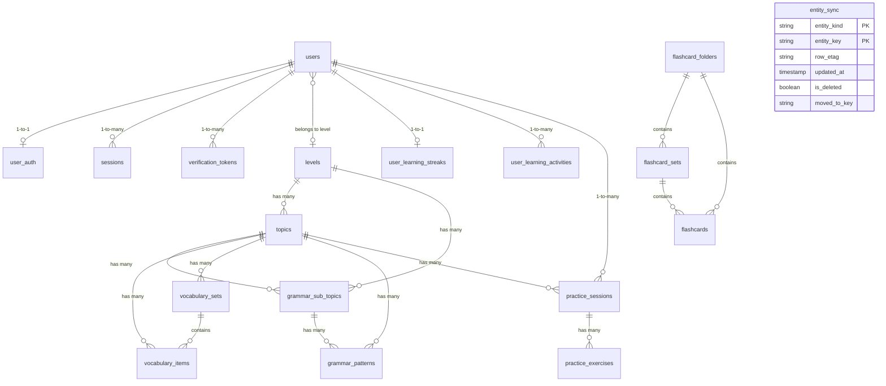

# TỔNG QUAN HỆ CƠ SỞ DỮ LIỆU NIHONIX (DATABASE OVERVIEW)

> **Cơ sở dữ liệu**: PostgreSQL 16  
> **ORM**: TypeORM 0.3.27  
> **Tổng số Entity**: 18 Entities tương ứng 18 bảng trong cơ sở dữ liệu  
> **Cơ chế quản lý Schema**: TypeORM Synchronize (`DATABASE_SYNCHRONIZE=true`)

---

## 1. SƠ ĐỒ QUAN HỆ THỰC THỂ (ENTITY RELATIONSHIP DIAGRAM)

---

## 2. CHI TIẾT CÁC BẢNG TRONG CƠ SỞ DỮ LIỆU

### 2.1. Nhóm Xác thực & Người dùng

#### 1. `users`
- **Mục đích**: Lưu thông tin hồ sơ người dùng.
- **Cột**:
  - `id` (UUID, Primary Key, auto-generated)
  - `username` (varchar 50, UNIQUE, NOT NULL)
  - `email` (varchar 255, UNIQUE, NOT NULL)
  - `full_name` (varchar 100, NULL)
  - `avatar_url` (text, NULL)
  - `language` (varchar 10, DEFAULT `'vi'`, NOT NULL)
  - `status` (varchar 20, DEFAULT `'active'`, NOT NULL)
  - `role` (enum `'user' | 'admin'`, DEFAULT `'user'`, NOT NULL)
  - `level_code` (varchar 10, NULL, Foreign Key -> `levels.code` ON DELETE SET NULL)
  - `created_at` (timestamptz, DEFAULT `CURRENT_TIMESTAMP`)
  - `updated_at` (timestamptz, DEFAULT `CURRENT_TIMESTAMP`)

#### 2. `user_auth`
- **Mục đích**: Lưu trữ thông tin nhạy cảm phục vụ xác thực tài khoản.
- **Cột**:
  - `user_id` (UUID, Primary Key, Foreign Key -> `users.id` ON DELETE CASCADE)
  - `password_hash` (varchar 255, NOT NULL)
  - `token_version` (int, DEFAULT `0`, NOT NULL) - Dùng để vô hiệu hóa token cũ khi đổi mật khẩu
  - `updated_at` (timestamptz, DEFAULT `CURRENT_TIMESTAMP`)

#### 3. `sessions`
- **Mục đích**: Lưu các phiên đăng nhập và Refresh Token của người dùng.
- **Cột**:
  - `id` (varchar 255, Primary Key)
  - `user_id` (UUID, NOT NULL, Foreign Key -> `users.id` ON DELETE CASCADE)
  - `refresh_token_hash` (varchar 255, NOT NULL)
  - `user_agent` (text, NULL)
  - `ip` (varchar 45, NULL)
  - `expires_at` (timestamptz, NOT NULL)
  - `created_at` (timestamptz, DEFAULT `CURRENT_TIMESTAMP`)

#### 4. `verification_tokens`
- **Mục đích**: Lưu mã OTP xác thực (quên mật khẩu, kích hoạt tài khoản).
- **Cột**:
  - `id` (UUID, Primary Key, auto-generated)
  - `user_id` (UUID, NOT NULL, Foreign Key -> `users.id` ON DELETE CASCADE)
  - `type` (varchar 50, NOT NULL, ví dụ `'password_reset'`)
  - `token_hash` (varchar 255, NOT NULL) - Mã OTP 6 số đã được băm bằng bcrypt
  - `expires_at` (timestamptz, NOT NULL)
  - `used_at` (timestamptz, NULL)
  - `created_at` (timestamptz, DEFAULT `CURRENT_TIMESTAMP`)

---

### 2.2. Nhóm Nội dung Học tập (Curriculum & Lessons)

#### 5. `levels`
- **Mục đích**: Các cấp độ tiếng Nhật (JLPT N5, N4, N3, N2, N1).
- **Cột**:
  - `code` (varchar 10, Primary Key) - Giá trị: `'N5'`, `'N4'`, `'N3'`, `'N2'`, `'N1'`
  - `name` (jsonb, NOT NULL) - Đối tượng đa ngôn ngữ: `{"vi": "...", "en": "...", "jp": "..."}`
  - `description` (jsonb, NULL)
  - `order` (int, DEFAULT `1`, NOT NULL)
  - `created_at` (timestamptz, DEFAULT `CURRENT_TIMESTAMP`)
  - `updated_at` (timestamptz, DEFAULT `CURRENT_TIMESTAMP`)

#### 6. `topics`
- **Mục đích**: Chủ đề / Bài học lớn trong từng trình độ.
- **Cột**:
  - `id` (UUID, Primary Key, auto-generated)
  - `slug` (varchar 100, UNIQUE, NOT NULL)
  - `level_code` (varchar 10, NOT NULL, Foreign Key -> `levels.code` ON DELETE CASCADE)
  - `title` (jsonb, NOT NULL) - Đa ngôn ngữ `{ vi, en, jp }`
  - `icon_svg` (text, NULL)
  - `icon_type` (varchar 50, DEFAULT `'material'`, NULL)
  - `icon_code` (varchar 100, NULL)
  - `order` (int, DEFAULT `1`, NOT NULL)
  - `created_at` (timestamptz, DEFAULT `CURRENT_TIMESTAMP`)
  - `updated_at` (timestamptz, DEFAULT `CURRENT_TIMESTAMP`)

#### 7. `grammar_sub_topics`
- **Mục đích**: Phân nhánh chủ đề ngữ pháp con trong từng topic.
- **Cột**:
  - `id` (UUID, Primary Key, auto-generated)
  - `slug` (varchar 100, UNIQUE, NOT NULL)
  - `topic_id` (UUID, NULL, Foreign Key -> `topics.id` ON DELETE CASCADE)
  - `topic_slug` (varchar 100, NULL)
  - `level_code` (varchar 10, NOT NULL, Foreign Key -> `levels.code` ON DELETE CASCADE)
  - `title` (jsonb, NOT NULL) - Đa ngôn ngữ `{ vi, en, jp }`
  - `description` (jsonb, NULL)
  - `order` (int, DEFAULT `1`, NOT NULL)
  - `created_at` (timestamptz, DEFAULT `CURRENT_TIMESTAMP`)
  - `updated_at` (timestamptz, DEFAULT `CURRENT_TIMESTAMP`)

#### 8. `grammar_patterns`
- **Mục đích**: Các mẫu ngữ pháp chi tiết.
- **Cột**:
  - `id` (UUID, Primary Key, auto-generated)
  - `slug` (varchar 100, UNIQUE, NOT NULL)
  - `grammar_sub_topic_slug` (varchar 100, NOT NULL, Foreign Key -> `grammar_sub_topics.slug` ON DELETE CASCADE)
  - `topic_slug` (varchar 100, NULL)
  - `level_code` (varchar 10, NULL)
  - `pattern` (varchar 255, NOT NULL) - Mẫu ngữ pháp (VD: `〜てください`)
  - `meaning` (jsonb, NOT NULL) - Nghĩa `{ vi, en, jp }`
  - `usage` (jsonb, NULL) - Hướng dẫn sử dụng
  - `examples` (jsonb, NOT NULL) - Danh sách các câu ví dụ
  - `order` (int, DEFAULT `1`, NOT NULL)
  - `created_at` (timestamptz, DEFAULT `CURRENT_TIMESTAMP`)
  - `updated_at` (timestamptz, DEFAULT `CURRENT_TIMESTAMP`)

#### 9. `vocabulary_sets`
- **Mục đích**: Bộ gom nhóm từ vựng theo chủ đề (một topic có thể có nhiều bộ từ).
- **Cột**:
  - `id` (UUID, Primary Key, auto-generated)
  - `slug` (varchar 100, UNIQUE, NOT NULL)
  - `topic_id` (UUID, NOT NULL, Foreign Key -> `topics.id` ON DELETE CASCADE)
  - `title` (jsonb, NOT NULL) - Tiêu đề bộ từ `{ vi, en, jp }`
  - `description` (text, NULL)
  - `order` (int, DEFAULT `1`, NOT NULL)
  - `created_at` (timestamptz, DEFAULT `CURRENT_TIMESTAMP`)
  - `updated_at` (timestamptz, DEFAULT `CURRENT_TIMESTAMP`)

#### 10. `vocabulary_items`
- **Mục đích**: Từng mục từ vựng tiếng Nhật.
- **Cột**:
  - `slug` (varchar 100, Primary Key) - Khóa chính là chuỗi slug
  - `topic_id` (UUID, NOT NULL, Foreign Key -> `topics.id` ON DELETE CASCADE)
  - `vocabulary_set_id` (UUID, NULL, Foreign Key -> `vocabulary_sets.id` ON DELETE CASCADE)
  - `topic_slug` (varchar 100, NULL)
  - `level_code` (varchar 10, NULL)
  - `romaji` (varchar 255, NOT NULL)
  - `kanji` (varchar 255, NULL)
  - `kana` (varchar 255, NOT NULL)
  - `meaning` (jsonb, NOT NULL) - Nghĩa `{ vi, en, jp }`
  - `word_type` (varchar 50, NOT NULL) - Từ loại (noun, verb, adjective, ...)
  - `title` (jsonb, NULL)
  - `examples` (jsonb, NOT NULL) - Mảng các câu ví dụ
  - `order` (int, DEFAULT `1`, NOT NULL)
  - `created_at` (timestamptz, DEFAULT `CURRENT_TIMESTAMP`)
  - `updated_at` (timestamptz, DEFAULT `CURRENT_TIMESTAMP`)

---

### 2.3. Nhóm Flashcard (Toàn cục)

#### 11. `flashcard_folders`
- **Cột**: `id` (UUID PK), `slug` (text UNIQUE, NULL), `name` (text), `description` (text NULL), `order` (int DEFAULT 1), `created_at`, `updated_at`.
- *Lưu ý*: Không có `user_id`.

#### 12. `flashcard_sets`
- **Cột**: `id` (UUID PK), `folder_id` (UUID, FK -> `flashcard_folders.id` ON DELETE CASCADE), `name` (varchar 255), `slug` (text UNIQUE, NULL), `order` (int DEFAULT 1), `created_at`, `updated_at`.

#### 13. `flashcards`
- **Cột**: `id` (UUID PK), `slug` (text UNIQUE, NULL), `folder_id` (UUID, FK -> `flashcard_folders.id`), `set_id` (UUID, FK -> `flashcard_sets.id` ON DELETE CASCADE), `front` (jsonb), `back` (jsonb), `order` (int DEFAULT 1), `created_at`, `updated_at`.

---

### 2.4. Nhóm Luyện tập & Streak

#### 14. `practice_sessions`
- **Cột**:
  - `id` (UUID, Primary Key)
  - `user_id` (UUID, NOT NULL, FK -> `users.id` ON DELETE CASCADE)
  - `topic_id` (UUID, NOT NULL, FK -> `topics.id` ON DELETE CASCADE)
  - `level_code` (varchar 10, NOT NULL)
  - `exercise_type` (varchar 50, NOT NULL: `'fill_blank'` | `'multiple_choice'`)
  - `status` (varchar 20, DEFAULT `'in_progress'`)
  - `total_questions` (int, NOT NULL)
  - `correct_answers` (int, DEFAULT 0)
  - `score` (numeric 5,2, DEFAULT 0)
  - `created_at`, `completed_at`

#### 15. `practice_exercises`
- **Cột**:
  - `id` (UUID, Primary Key)
  - `session_id` (UUID, NOT NULL, FK -> `practice_sessions.id` ON DELETE CASCADE)
  - `question_text` (text, NOT NULL)
  - `question_jp` (text, NOT NULL)
  - `options` (jsonb, NULL) - Dành cho trắc nghiệm (mảng 4 đáp án)
  - `correct_answer` (text, NOT NULL)
  - `user_answer` (text, NULL)
  - `is_correct` (boolean, NULL)
  - `explanation` (text, NULL)
  - `order` (int, DEFAULT 1)

#### 16. `user_learning_streaks`
- **Cột**:
  - `id` (UUID, Primary Key)
  - `user_id` (UUID, UNIQUE, NOT NULL, FK -> `users.id` ON DELETE CASCADE)
  - `current_streak` (int, DEFAULT 0)
  - `longest_streak` (int, DEFAULT 0)
  - `last_learned_date` (date, NULL)
  - `streak_start_date` (date, NULL)
  - `total_learning_days` (int, DEFAULT 0)
  - `created_at`, `updated_at`

#### 17. `user_learning_activities`
- **Cột**:
  - `id` (UUID, Primary Key)
  - `user_id` (UUID, NOT NULL, FK -> `users.id` ON DELETE CASCADE)
  - `activity_date` (date, NOT NULL)
  - `activity_count` (int, DEFAULT 1)
  - `activity_type` (varchar 50, NOT NULL)
  - `created_at`, `updated_at`

---

### 2.5. Nhóm Đồng bộ Dữ liệu

#### 18. `entity_sync`
- **Mục đích**: Bảng quản trị ETag phục vụ đồng bộ dữ liệu Offline Sync cho ứng dụng di động.
- **Cột**:
  - `entity_kind` (enum `'level' | 'topic'`, Primary Key composite 1)
  - `entity_key` (varchar 255, Primary Key composite 2)
  - `row_etag` (varchar 64, NOT NULL)
  - `updated_at` (timestamptz, DEFAULT `CURRENT_TIMESTAMP`)
  - `is_deleted` (boolean, DEFAULT `false`)
  - `moved_to_key` (varchar 255, NULL)

---

## 3. ĐỐI CHIẾU THỰC TẾ VỚI TÀI LIỆU ĐẶC TẢ (DOCS VS CODE)

| Nội dung trong tài liệu `docs/` | Triển khai thực tế trong Source Code | Đánh giá & Rủi ro |
|---|---|---|
| Bảng `content_items` trong `ddl-schema.md` | **Không tồn tại**. Code tách trực tiếp thành 2 bảng riêng biệt là `vocabulary_items` và `grammar_patterns`. | Thực tế code trực quan và dễ truy vấn hơn so với thiết kế đa hình (polymorphic) phức tạp ban đầu. |
| Bảng `flashcard_groups` trong migrations cũ | Đã được đổi tên (refactor) thành `flashcard_sets`. | Code đã đồng bộ với `flashcard_sets`. |
| Cột Khóa ngoại Topic trong `vocabulary_items` | Ban đầu dùng `topic_slug`, hiện tại dùng `topic_id` (UUID) và `vocabulary_set_id` (UUID). | Quan hệ chuẩn khóa ngoại UUID. |
| Migration files trong `src/database/migrations` | Thư mục rỗng (chỉ có `.gitkeep`). Các file SQL nằm ngoài ở thư mục `migrations/`. | Hệ thống không chạy migrations tự động mà hoàn toàn phụ thuộc vào `synchronize: true`. |
| Dữ liệu Seeding sẵn có | Seed chỉ nạp: Admin, Levels N5/N4/N3, Topics, 61 Grammar Sub-topics. | **Từ vựng (Vocabulary Items) và Mẫu ngữ pháp (Grammar Patterns) đang là 0 bản ghi**. |

